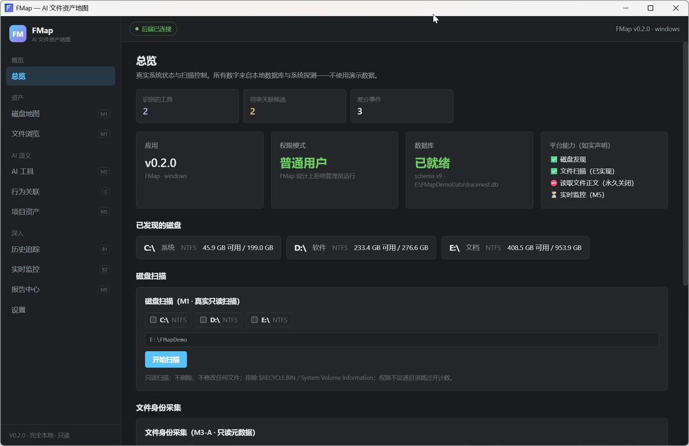
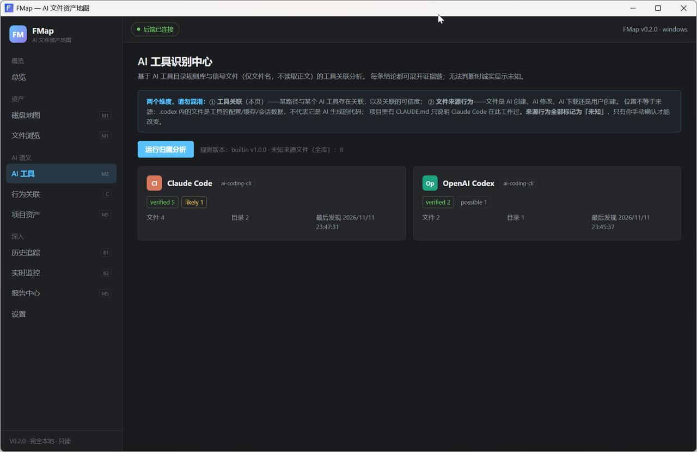
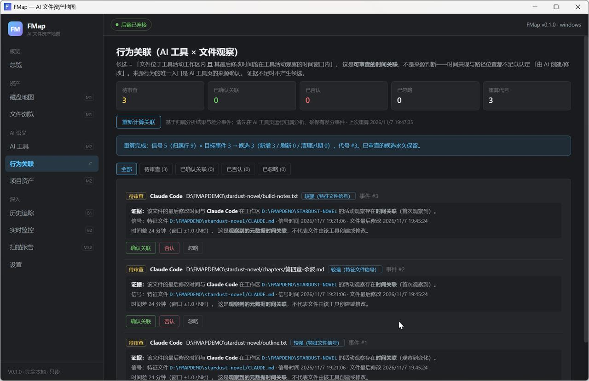
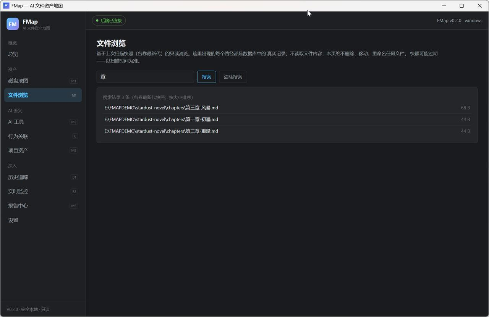
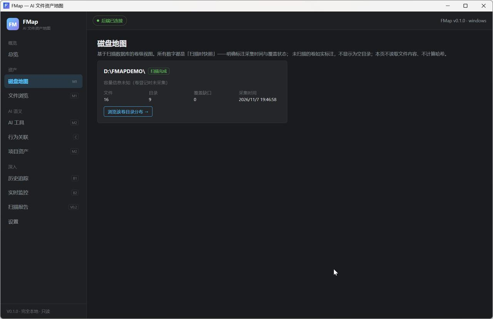
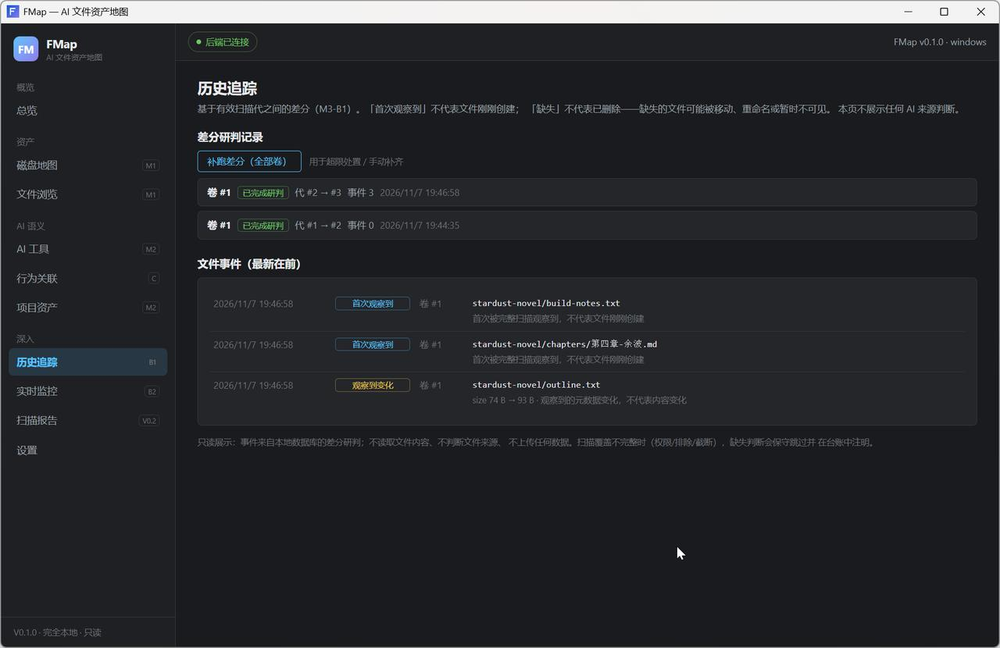

<div align="center">

# FMap

**让 AI 在电脑上留下的每一个文件，都有迹可循。**

*Every file left behind by AI on your computer, accounted for.*

[](https://github.com/Yangxbao/FMap/actions/workflows/ci.yml)
[](#%EF%B8%8F-快速上手)
[](https://www.rust-lang.org/)
[](#license)
[](https://github.com/Yangxbao/FMap/releases)

**本地运行 · 完全只读 · 零网络出站 · 不需要管理员**

[功能总览](#-它能做什么) · [界面预览](#-界面预览) · [快速上手](#%EF%B8%8F-快速上手) · [工作原理](#-工作原理) · [参与共建](#-参与共建)



</div>

---

## 🤔 为什么需要 FMap？

如果你日常使用 Claude Code、Codex、Cursor、Gemini CLI、ZCode 这类 AI 工具，
几天之后你的电脑上会多出成百上千个文件——而你很可能回答不了这些问题：

- AI 把项目、缓存、下载的模型都放到了哪里？
- 某个 AI 工具实际占了多少空间？卸载时哪些文件能安全删？
- 过去一周 AI 新生成了什么？哪些文件发生了变化？哪些消失了？
- **这个文件到底是 AI 创建的，还是我自己创建的？**

文件管理器看不到"来源"，AI 工具自己也说不清散落各处的产物。
FMap 用**纯只读**的方式回答这些问题——它是一个"文件资产的账本"。

## ✨ 它能做什么？

| 能力 | 说明 | 默认状态 |
|---|---|---|
| 🔍 **只读多磁盘扫描** | 只读元数据遍历（路径/大小/时间），110K 行/秒批量入库，权限不足逐目录记录缺口 | 授权后可用 |
| 🧠 **AI 工具识别** | 内置 15 工具 / 29 规则（数据目录 + 特征文件），四级证据归属引擎 | 扫描后一键运行 |
| 🕐 **文件事件追踪** | 相邻两次扫描自动差分：首次观察到 / 观察到变化 / 缺失（待确认）/ 重新出现 | 自动 |
| 🔗 **行为关联（M3-C）** | "这个文件的修改时间，恰好落在 Claude 在同一工作区活动的窗口内"——可审查的时间关联候选，**绝不**自动认定"AI 创建" | 手动计算 |
| 🌐 **浏览器下载关联（M3-D）** | 逐浏览器逐档案授权后，把下载记录与扫描结果做候选匹配 | **默认关闭** |
| 📂 **磁盘地图 / 文件浏览** | 基于扫描快照的卷级视图 + 全文搜索 + 归属详情 | 随扫描可用 |
| 👤 **文件身份（M3-A）** | 卷 GUID + NTFS FileId 主身份，跨盘符追踪同一文件 | **默认关闭** |
| 📡 **实时目录监控（M3-B2）** | 逐目录授权的 RDCW 采集，溢出自动对账闭环 | **默认关闭** |

> **核心原则：关联 ≠ 来源。**
> 位置相近、时间重合都不足以认定"AI 创建"——所有自动分析的结果永远显示
> 「未知」，只有你亲手确认，来源行为才会改变。

## 🖼 界面预览

| AI 工具识别中心 | 行为关联（可审查候选） |
|---|---|
|  |  |

每条结论都附带可展开的证据链（命中了哪条规则、哪个信号文件）；
每条关联候选都写明时间差、窗口和信号来源——**可解释、可否认、可撤销**。

| 文件浏览（快照 + 搜索） | 磁盘地图 | 历史追踪 |
|---|---|---|
|  |  |  |

<sub>*以上截图均来自虚构演示数据，不含任何真实个人信息。</sub>

## ⚡️ 快速上手

### 方式一：从源码运行（当前版本推荐）

```bash
git clone https://github.com/Yangxbao/FMap.git
cd FMap
npm install --prefix apps/desktop/ui        # 前端依赖
cargo tauri dev                             # 需要 Rust + MSVC，见下
```

<details>
<summary><b>构建前置条件（展开）</b></summary>

- Windows 10 / 11
- [Rust](https://rustup.rs/) stable（MSVC target）
- [Visual Studio Build Tools](https://visualstudio.microsoft.com/visual-cpp-build-tools/)（C++ 工作负载）
- [Node.js](https://nodejs.org/) ≥ 22.5（`node:sqlite` 用于仓库级测试）

</details>

发布构建：

```bash
npm run build --prefix apps/desktop/ui
cargo build --release -p tracenest-desktop --features custom-protocol
# 产物：target/release/tracenest-desktop.exe（单文件，免安装）
```

### 方式二：三步用起来

<div align="center">

**① 扫描** → 在总览页勾选磁盘或填一个具体目录，点「开始扫描」
**② 识别** → 到「AI 工具」页点「运行归属分析」，看哪些目录属于哪个 AI 工具
**③ 追踪** → 以后随时再扫一次，「历史追踪」自动告诉你什么变了

</div>

想试「行为关联」？在同一工作区里用 AI 工具干活 → 再扫一次 →
到「行为关联」页点「重新计算关联」——它会列出
*"这个文件的修改时间落在 Claude 活动窗口内"* 的候选，由你审查。

### 数据存哪里？

`%APPDATA%\io.github.tracenest.desktop\tracenest.db`（SQLite，WAL 模式）。
设置页可随时撤销授权并删除对应数据；设置 `FMAP_DB_PATH` 环境变量可自定义数据库位置。

## 🔬 工作原理

```
Tauri 2 壳（React 19 + TypeScript + Tailwind v4）
    │
    ├── crates/core        纯逻辑：扫描引擎 · 归属引擎 · 关联引擎 · 路径规范化
    ├── crates/database    SQLite(WAL+FTS5)：版本化迁移 · 差分 · 身份 · 来源模型
    └── crates/platform    Windows：磁盘发现 · NTFS FileId · RDCW 监控 · USN 能力探测
```

**三层分模型**（项目的语义基石，也是它"不骗人"的原因）：

```
第 1 层 原始事件与证据  —— append-only，一经写入永不被覆盖
第 2 层 自动候选        —— 可整体重建，永远诚实标注置信级别
第 3 层 用户确认        —— append-only 修正历史，最高可信，唯一能改变来源行为的入口
```

更多设计文档见 [docs/architecture](docs/architecture/) 与 [docs/research](docs/research/)。

## 🛡 隐私与安全承诺

| 承诺 | 说明 |
|---|---|
| ✅ 零网络出站 | 无遥测、无上报、无第三方 API、无账号——代码里没有网络客户端 |
| ✅ 完全只读 | 不删除、不移动、不重命名用户文件（CI 有 grep 门禁强制） |
| ✅ 不读文件内容 | 只用元数据（路径/大小/时间/身份）；不计算内容哈希 |
| ✅ 不读 AI 会话数据 | 不读取聊天记录、会话数据库、JSONL 正文 |
| ✅ 不需要管理员 | 设计上拒绝提权运行；卷级 USN 等需管理员的能力直接不做 |
| ✅ 敏感功能默认关闭 | 身份采集 / 目录监控 / 浏览器记录均逐项授权，可随时暂停、撤销、清除数据 |
| ✅ 未知就是未知 | 证据不足永远显示「未知」，不猜测、不编造来源 |

## 🗺 路线图

- [x] M0–M2：扫描引擎 · AI 工具识别 · 识别中心
- [x] M3-A/B：文件身份 · 事件追踪 · 实时监控
- [x] M3-C：行为关联（时间关联候选）
- [x] M3-D：浏览器下载记录（Chrome / Edge）
- [x] M3-E：USN 能力探测（单文件 USN 已实现；卷级红线内不启用）
- [x] M4：磁盘地图 · 文件浏览 · 实时监控页
- [x] 项目资产 · 报告中心 · 历史页 v2 · 差分超限处置
- [x] NSIS 安装包（真机安装/卸载验证）
- [ ] M5 收尾：长期运行稳定性 · macOS/Linux 适配
- [ ] 跨平台（Linux / macOS——架构已按 trait 抽象，见 [兼容性说明](docs/architecture/PLATFORM_COMPATIBILITY.md)）
- [ ] 规则包社区共建（新增 AI 工具识别规则）

## 🤝 参与共建

**FMap 还在早期，非常欢迎各种形式的贡献——包括不会 Rust 的你：**

| 贡献轨道 | 适合谁 | 从哪开始 |
|---|---|---|
| 🧩 **补充 AI 工具识别规则** | 任何用过某个 AI 工具的人 | 编辑 [`rules/builtin-rules-v1.json`](rules/builtin-rules-v1.json)，为你的工具添加数据目录/特征文件规则（只需 JSON） |
| 🐛 **Issue 反馈** | 所有用户 | 扫描结果不对？UI 崩了？识别遗漏？[开一个 Issue](https://github.com/Yangxbao/FMap/issues/new) |
| 🦀 **Rust / 前端开发** | 开发者 | 从 `good first issue` 标签挑任务；先读 [CONTRIBUTING.md](CONTRIBUTING.md)（含硬性红线） |
| 📖 **文档 / 翻译** | 写作者 | 完善 README、设计文档、英文版翻译 |

提 PR 前请务必读 [CONTRIBUTING.md](CONTRIBUTING.md)——其中"只读、无提权、零网络出站"
是**会被 CI 直接拒绝**的硬性红线。

## ❓ FAQ

<details>
<summary><b>它会改动我的文件吗？</b></summary>

不会。FMap 只读取文件的元数据（路径/大小/时间戳），数据库写在它自己的应用目录里。
只读承诺由 CI 中的 grep 门禁强制执行——任何删除/移动/重命名 API 出现在源码里，构建直接失败。
</details>

<details>
<summary><b>为什么显示"未知"而不是直接告诉我这是 AI 创建的？</b></summary>

因为"文件在 AI 工具的数据目录附近、时间也吻合"只能证明**关联**，不能证明**来源**——
你自己也会把文件存到那些目录。FMap 选择诚实：自动分析只给候选与证据链，
最终判断权在你（来源确认面板）。
</details>

<details>
<summary><b>需要管理员权限吗？会不会读取我的浏览记录？</b></summary>

不需要管理员，设计上拒绝提权。浏览器下载记录功能**默认关闭**，逐浏览器逐档案授权，
只读取下载条目（目标路径/URL/时间），绝不触碰浏览历史、Cookie 或密码；随时可撤销并清除数据。
</details>

<details>
<summary><b>支持 macOS / Linux 吗？</b></summary>

核心逻辑（扫描/差分/关联）是平台无关的，Windows 优先交付。跨平台按 trait 抽象逐项适配，
没有实现的能力会诚实报告"不支持"而不是装样子。
</details>

## License

MIT OR Apache-2.0（双许可）

---

<div align="center">

**如果 FMap 对你有用，点个 ⭐ 让更多人看到。**

</div>
